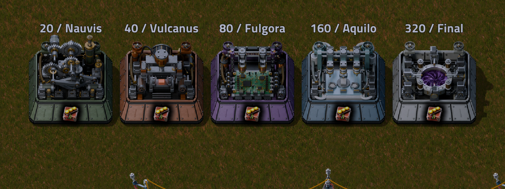

# FactorioMods agent knowledge

Reusable project instructions and searchable engineering knowledge for **GPT-6 Astra**, **GPT-6.1 Sol**, and other coding agents. Captured 2026-10-14 from the FactorioMods development conversation and checked against available local source files.

Start with [START-HERE.md](START-HERE.md) and [AGENTS.md](AGENTS.md).

The repository includes design requirements, failures and corrections, Blender rendering/rigging practices, native Factorio integration, test recipes, multiplayer lessons, release boundaries, reference images and a machine-readable knowledge database. It deliberately does not bundle private savegames, credentials or raw logs.

## Search

```sh
python tools/build_database.py
python tools/query.py "gear"
python tools/query.py "alt"
python tools/validate.py
```

Markdown and JSONL are canonical. SQLite is rebuildable with Python's standard library. No embeddings, hosted service, API key or model-specific database is required.

## Visual evidence

The following is the **local 1.0.10** adjacent-placement and Alt-mode check, not the older 1.0.9 public gallery:



## Scope and limitations

Historical requirements are preserved, but old completion claims are not treated as fresh validation. See [current state](knowledge/current-state.md) and [sources](SOURCES.md). Records distinguish local code inspection, prior test evidence, user requirements and unverified historical claims. Model source files remain on the original workstation; hashes and relative paths are indexed for recovery. This is a curated handoff, not a raw transcript archive.
